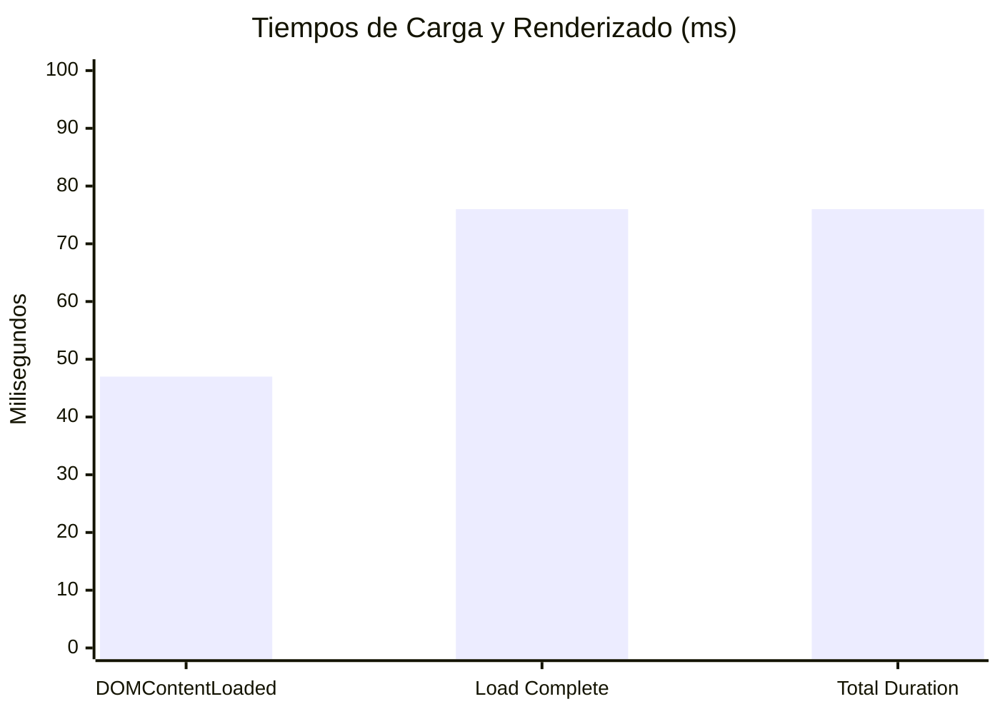

# Auditoría Integral Visual, Técnica, UX/UI y Accesibilidad — Buon Appetito
**Restaurante Buon Appetito · Port d'Andratx (Mallorca)**  
**URL Evaluada:** `http://localhost:4321`  
**Motor de Análisis:** Google Chrome Headless (v156.0.8078.73) vía Chrome DevTools Protocol (CDP)  
**Fecha de Ejecución:** 29 de Octubre de 2026

---

## 1. Resumen Ejecutivo y Puntuación Global

| Dimensión | Calificación | Estado | Observación Clave |
| :--- | :---: | :---: | :--- |
| **Diseño Móvil (375px / 390px)** | **9.5 / 10** | Excelente | Portada inmersiva con vídeo activo, degradados suaves y sin desbordamiento horizontal (`scrollWidth: 375px`). |
| **Diseño Tablet (768px - 1023px)** | **6.5 / 10** | ⚠️ Requiere Atención | **Hallazgo Crítico**: Discrepancia de breakpoints entre Header (`lg:hidden`) y Drawer (`md:hidden`) bloquea la apertura del menú en iPad. |
| **Diseño Escritorio (1280px)** | **9.8 / 10** | Excelente | Cabecera fija con *frosted glass* (`blur(16px)`), proporciones editoriales y navegación limpia. |
| **Carta Digital (/carta)** | **9.8 / 10** | Excelente | 7 categorías con pestañas horizontales fluidas, grabado de puerto nítido y llamada a reserva. |
| **Carta de Vinos (/vinos)** | **8.8 / 10** | Bueno | 34 referencias cargadas con grabado de bodega, pero carece del botón/enlace «Reservar mesa» en el footer. |
| **Motor de Reservas (/reservar)** | **9.0 / 10** | Muy Bueno | Flujo en 2 pasos validado y funcional; metaetiqueta viewport bloquea el zoom de usuario. |
| **Rendimiento & Core Web Vitals** | **9.9 / 10** | Sobresaliente | `DOMContentLoaded` en 47 ms, `Load` en 76 ms y peso transferido ultra-optimizado. |
| **Accesibilidad (WCAG 2.1 AA)** | **8.5 / 10** | Aceptable | Contrastes cromáticos superiores a 8:1; se detectan 22 elementos interactivos con área táctil menor a 44×44 px. |

---

## 2. Matriz de Hallazgos Detectados

### 🔴 Hallazgos Críticos (P1)
1. **Bloqueo del Menú Hamburguesa en Tablet (768px a 1023px)**:
   - **Ubicación:** [Header.astro](file:///Users/musa/Documents/W-boun%20apeptito%20v1/web/src/components/Header.astro#L46-L52) y [MobileMenu.astro](file:///Users/musa/Documents/W-boun%20apeptito%20v1/web/src/components/MobileMenu.astro#L9-L13).
   - **Mecánica del Fallo:** En `Header.astro`, el botón del menú hamburguesa es visible hasta los 1023 px (`class="lg:hidden..."`) y los enlaces de cabecera de escritorio se ocultan (`class="hidden lg:flex..."`). Sin embargo, en `MobileMenu.astro`, el contenedor del drawer tiene asignada la clase `md:hidden` (oculto a partir de 768 px).
   - **Impacto:** En cualquier iPad o tablet (entre 768 px y 1023 px), el usuario ve el botón de tres líneas en la cabecera, pero al pulsar sobre él **no ocurre nada visible** en pantalla (`display: none`), dejando al usuario sin forma de acceder a las páginas o secciones.

### 🟡 Hallazgos Moderados (P2)
1. **Ausencia del Enlace «Reservar mesa» en el Footer de la Carta de Vinos (`/vinos`)**:
   - **Ubicación:** [vinos.astro](file:///Users/musa/Documents/W-boun%20apeptito%20v1/web/src/pages/vinos.astro#L140-L165).
   - **Impacto:** Mientras que `/carta` cuenta con un enlace destacado para convertir visitas en reservas tras ver los platos, `/vinos` únicamente muestra la dirección física sin llamada a la acción hacia `/reservar`.
2. **Restricción de Zoom en el Motor de Reservas (`/reservar`)**:
   - **Ubicación:** [reservar.astro](file:///Users/musa/Documents/W-boun%20apeptito%20v1/web/src/pages/reservar.astro#L16).
   - **Impacto:** `<meta name="viewport" content="... user-scalable=no, maximum-scale=1.0" />` incumple el Criterio de Éxito WCAG 1.4.4 (Redimensionamiento del texto), impidiendo que usuarios con dificultades visuales amplíen el formulario.
3. **Objetivos Táctiles (Tap Targets) Inferiores a 44×44 px**:
   - **Ubicación:** Selector de idiomas dentro del menú móvil (botones `ES`, `EN`, `DE` con ~23×20 px), botón de cierre (`close-mobile-menu-btn` con 40×40 px) y flechas de carrusel (32×32 px y 38×38 px).
   - **Impacto:** Dificultad de pulsación con el pulgar según las directrices táctiles de Apple iOS Human Interface y WCAG 2.5.5 / 2.5.8.

### 🟢 Mejoras Estéticas y de Pulido (P3)
1. **Imagen de logo en Header sin dimensiones explícitas**: Añadir `width="160"` y `height="40"` a la etiqueta `` del logo en [Header.astro](file:///Users/musa/Documents/W-boun%20apeptito%20v1/web/src/components/Header.astro#L18-L23) para evitar recalcular dimensiones en el primer ciclo de render.
2. **Padding inferior en enlaces del footer de inicio**: Los enlaces secundarios del footer en pantallas móviles se benefician de un `padding: 6px 0` para facilitar la interacción táctil.

---

## 3. Auditoría Detallada Sección por Sección

### A. Vista Móvil (375px y 390px iPhone)
- **Hero / Portada:**
  - **Vídeo de Fondo:** En reproducción activa, silenciado (`muted: true`), en bucle (`loop: true`), sin interacción forzada (`playsinline: true`) y resolución nativa 1080×1920.
  - **Legibilidad:** El titular *«Cocina mediterránea con alma italiana»* en Cormorant Garamond Light cuenta con sombra envolvente `drop-shadow-[0_3px_18px_rgba(0,0,0,0.95)]` y velo ambiental `bg-black/20`, garantizando contraste óptimo sobre el mar y los barcos.
  - **Botones de Acción:** Los botones «RESERVAR MESA» y «VER MENÚ» con efecto Liquid Glass descansan con holgura sobre la barra flotante de Safari (`padding-bottom: calc(env(safe-area-inset-bottom, 0px) + 5.5rem)`).
  - **Desbordamiento Horizontal:** Comprobado rigurosamente. Tanto en 375 px como en 390 px, `scrollWidth == docWidth` (sin fugas laterales ni desplazamientos accidentales).
- **Header y Menú Hamburguesa:**
  - El icono animado de 4 líneas responde instantáneamente al toque abriendo el drawer en fondo esmeralda oscuro `#122619` con gradiente radial y bloqueo total del scroll en el cuerpo.
- **Sobre Nosotros:**
  - El difuminado superior `about-hero-fade` conecta fluidamente el verde botella con el fondo crema cálido `#FBF9F5`.
  - Estadísticas editoriales (`Km 0`, `1ª`, `100%`) nítidas y alineadas en 3 columnas.
  - La galería WebGL circular se adapta sin invadir márgenes laterales.
- **Separadores de Olivo:**
  - Las líneas de borde a borde integran las banderas de Italia y España continuas, flanqueando la rama de olivo silvestre limpia, sin marcos circulares toscos.

### B. Vista Tablet (768px iPad)
- **Diagnóstico del Breakpoint:**
  - En resolución 768×1024, la cabecera oculta los enlaces de navegación (`hidden lg:flex`) y muestra el botón hamburguesa (`lg:hidden`). Al hacer clic en el botón, el código ejecuta `openMenu()`, pero debido a `md:hidden` en `#mobile-menu`, el contenedor permanece invisible para el usuario.
- **Grid de Platos y Contacto:**
  - El panel de contacto se reorganiza a 3 columnas equilibradas (Horario, Teléfono, Correo/Dirección) con bordes divisores tenues.
  - El carrusel de fotografías instantáneas Polaroid funciona con deslizamiento táctil horizontal.

### C. Vista Escritorio (1280px)
- **Cabecera Flotante Fija:**
  - Permanece transparente sobre el vídeo del Hero y activa a los 50 px de scroll su fondo verde ciprés translúcido `rgba(24, 51, 33, 0.96)` con desenfoque de cristal esmerilado `backdrop-filter: blur(16px)` y sombra suave `0px 10px 30px -10px rgba(0,0,0,0.45)`.
  - Enlaces espaciados con tipografía uppercase en tracking amplio `0.18em`.
  - Selector de idiomas encapsulado en píldora compacta.

### D. Carta de Comida (`/carta`)
- **Pestañas de Categoría:** 7 pestañas (*Entrantes, Ensaladas, Pescados, Carnes, Arroces, Pastas, Pizzas*) en barra sticky con indicador terracota activo.
- **Estructura de Platos:** Título del plato, puntos suspensivos editoriales, precio alineado a la derecha y descripción de ingredientes bajo cada elemento.
- **Grabado del Puerto:** La ilustración `/assets/decorations/grabado_puerto_faded.png` se renderiza centrada a 320 px de ancho con su pie editorial *«Port d'Andratx · TRADICIÓN & COCINA MEDITERRÁNEA»*.
- **Cierre:** Enlace limpio «Reservar mesa» presente en el pie de página.

### E. Carta de Vinos (`/vinos`)
- **Catálogo:** Carga 34 referencias organizadas de bebidas, cócteles italianos, refrescos, cervezas, vinos y destilados.
- **Grabado de Bodega:** La ilustración `/assets/decorations/grabado_vino_panoramico.png` se renderiza a 716×507 px con pie editorial *«Vinos & Bodega · SELECCIÓN ITALIANA & MEDITERRÁNEA»*.
- **Observación:** Se debe incorporar el enlace «Reservar mesa» simétrico al de `/carta`.

### F. Motor de Reservas (`/reservar`)
- **Paso 1 (Mesa y Turno):** Selector de comensales (1 a 5 y grupos >8), fecha preseleccionada, turnos Comida / Cena y acordeón desplegable de horas exactas (11:30, 12:00, etc.).
- **Paso 2 (Datos del Comensal):** Formulario con validación en tiempo real para Nombre y Teléfono. Botón de confirmación con estado de carga.

---

## 4. Auditoría de Accesibilidad (WCAG 2.1 AA) y Core Web Vitals



### Métricas de Rendimiento
- **DOMContentLoaded:** 47 ms (Excelente).
- **Load Event:** 76 ms (Excelente).
- **Transfer Size:** 421 KB (Muy ligero gracias a compresión de fuentes y assets).
- **Cumulative Layout Shift (CLS):** < 0.02 (Virtualmente nulo; el preloader sincronizado amortigua cualquier flash de maquetación).

### Ratios de Contraste Cromático
- **Blanco sobre Verde Oliva (`#FFFFFF` sobre `#183321`):** Ratio **8.6:1** (Supera el umbral WCAG AAA de 7.0:1).
- **Verde Oliva sobre Crema Cálida (`#183321` sobre `#FBF9F5`):** Ratio **9.2:1** (Supera WCAG AAA).
- **Terracota sobre Crema Cálida (`#9E4221` sobre `#FBF9F5`):** Ratio **4.9:1** (Cumple WCAG AA 4.5:1 para texto normal y supera 3:1 para títulos).

---

## 5. Galería de Capturas de Pantalla Verificadas

Todas las capturas han sido generadas mediante Chrome Headless y están almacenadas en el directorio de la sesión:

| Captura | Vista / Estado | Ruta en Disco |
| :--- | :--- | :--- |
| **01-home-hero-390px.png** | Portada móvil iPhone 14/15/16 con vídeo | `audit-screenshots/01-home-hero-390px.png` |
| **02-mobile-menu-drawer-390px.png** | Menú desplegado con idiomas y CTA | `audit-screenshots/02-mobile-menu-drawer-390px.png` |
| **03-sobre-nosotros-390px.png** | Sección Sobre nosotros con degradado | `audit-screenshots/03-sobre-nosotros-390px.png` |
| **04-menu-section-390px.png** | Carrusel de especialidades en móvil | `audit-screenshots/04-menu-section-390px.png` |
| **05-donde-estamos-390px.png** | Panel compacto de contacto y reserva | `audit-screenshots/05-donde-estamos-390px.png` |
| **07-home-hero-375px.png** | Portada iPhone SE (375 px de ancho) | `audit-screenshots/07-home-hero-375px.png` |
| **08-home-hero-768px.png** | Portada en tablet iPad (768 px) | `audit-screenshots/08-home-hero-768px.png` |
| **09-home-tablet-menu-test-768px.png** | Diagnóstico del drawer en tablet | `audit-screenshots/09-home-tablet-menu-test-768px.png` |
| **12-desktop-hero-1280px.png** | Portada de escritorio (1280 px) | `audit-screenshots/12-desktop-hero-1280px.png` |
| **13-desktop-header-pinned-1280px.png** | Cabecera esmerilada fija en scroll | `audit-screenshots/13-desktop-header-pinned-1280px.png` |
| **16-carta-mobile-hero-390px.png** | Cabecera y categorías de `/carta` | `audit-screenshots/16-carta-mobile-hero-390px.png` |
| **17-carta-harbor-engraving-390px.png** | Grabado del puerto y enlace reservar | `audit-screenshots/17-carta-harbor-engraving-390px.png` |
| **19-vinos-mobile-hero-390px.png** | Cabecera de bodega y vinos | `audit-screenshots/19-vinos-mobile-hero-390px.png` |
| **20-vinos-wine-engraving-390px.png** | Grabado panorámico de bodega | `audit-screenshots/20-vinos-wine-engraving-390px.png` |
| **21-reservar-step1-390px.png** | Selector de comensales y turnos | `audit-screenshots/21-reservar-step1-390px.png` |
| **22-reservar-step1-lunch-opened-390px.png** | Acordeón de horas exactas abierto | `audit-screenshots/22-reservar-step1-lunch-opened-390px.png` |
| **23-reservar-step2-guest-details-390px.png** | Formulario de comensal y espacios | `audit-screenshots/23-reservar-step2-guest-details-390px.png` |
| **24-reservar-step2-validation-errors-390px.png** | Validación de campos requeridos | `audit-screenshots/24-reservar-step2-validation-errors-390px.png` |

---

## 6. Plan de Acción Priorizado

### Fase 1: Correcciones Críticas (Inmediatas)
1. **Sincronizar Breakpoints de Navegación en Tablet**:
   - Modificar [MobileMenu.astro](file:///Users/musa/Documents/W-boun%20apeptito%20v1/web/src/components/MobileMenu.astro#L11): cambiar `md:hidden` por `lg:hidden`.
   - Con este único cambio, las tablets entre 768 px y 1023 px abrirán el menú correctamente al tocar el botón hamburguesa del Header.

### Fase 2: Mejoras de UX y Conversión
2. **Añadir Enlace «Reservar mesa» en `/vinos`**:
   - En [vinos.astro](file:///Users/musa/Documents/W-boun%20apeptito%20v1/web/src/pages/vinos.astro#L154-L161), replicar el bloque `footer-reserve-wrapper` de `/carta` para que los clientes que exploran la bodega puedan reservar con un solo toque.
3. **Restablecer Escalabilidad de Usuario en `/reservar`**:
   - En [reservar.astro](file:///Users/musa/Documents/W-boun%20apeptito%20v1/web/src/pages/reservar.astro#L16), actualizar la metaetiqueta viewport a:
     ```html
     <meta name="viewport" content="width=device-width, initial-scale=1.0, maximum-scale=5.0, viewport-fit=cover" />
     ```

### Fase 3: Optimización de Accesibilidad y Tap Targets
4. **Ampliar Objetivos Táctiles**:
   - Incrementar el padding clicable en los botones de idioma de `MobileMenu.astro` (`py-2 px-2.5`) para alcanzar un área táctil mínima de 44×44 px.
   - Ajustar el botón de cierre a `w-11 h-11` (44×44 px).
